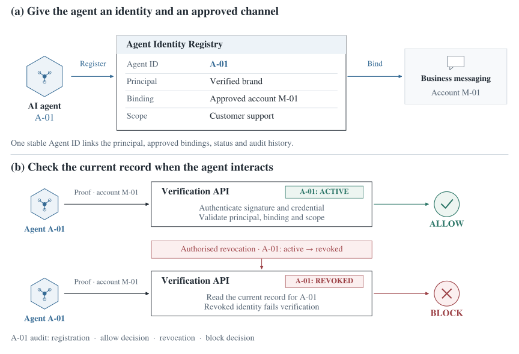

# Agent Identity & Trust

How can a messaging channel tell whether an AI agent really speaks for a brand when it starts a conversation? I designed **Agent Trust Gateway** around that decision. For this individual product management assignment, I researched what a channel operator would need to know, defined the identity checks and scoped a pilot for brand-owned support agents.

[Read the concept paper](docs/product-concept.pdf)

## One agent, two conversations

A brand registers its support agent and links it to an approved messaging account. That tells the channel who the brand expects to use the account. When a conversation starts, the channel still needs to establish who is calling and whether the agent has permission to act there.

I chose to check the agent’s signed proof against its current record at the start of each conversation. In the example below, agent **A-01** is active when it first contacts the channel through account **M-01**. After revocation, the next check reads the updated record and the channel blocks the conversation in this example. Both decisions stay attached to A-01, so a reviewer can follow what happened to the same agent.

## Where verification stops

The agent and the brand have separate identities. The brand is the **principal**, the party responsible for the agent. The channel also needs the agent’s **channel binding**, which identifies the account it may use and for what purpose. A support agent can therefore be verified for a conversation while a refund would still need its own approval. I put that approval flow in the second phase of the roadmap.

## The first pilot

I scoped the pilot around one messaging channel and a small group of brands, each registering one support agent. The brands need a channel that will use their registrations. The channel needs registered agents so it can try the check on traffic it expects to receive.

The first question I would take to a channel operator is what evidence they would need to allow a conversation, and what they would do if the same agent came back after revocation. The proposed pilot depends on their willingness to use that evidence in a live decision.

## Repository guide

| Document | What to look for |
| --- | --- |
| [Discovery](docs/discovery.md) | Why I chose the channel operator and which assumption still needs a conversation with one. |
| [Product definition](docs/product-definition.md) | The identity records, the Verification API and the channel’s decision. |
| [Roadmap](docs/roadmap.md) | What the pilot would need to demonstrate before adding a second channel or approving sensitive actions. |
| [Concept paper](docs/product-concept.pdf) | Full individual submission, including research, architecture and rollout. |
| [Assignment](docs/assignment.html) | Original discovery and product definition brief. |

*Fundamentals of Product Management at [FER Zagreb](https://www.fer.unizg.hr/en/course/fopm_a), with Infobip, 2026.*
