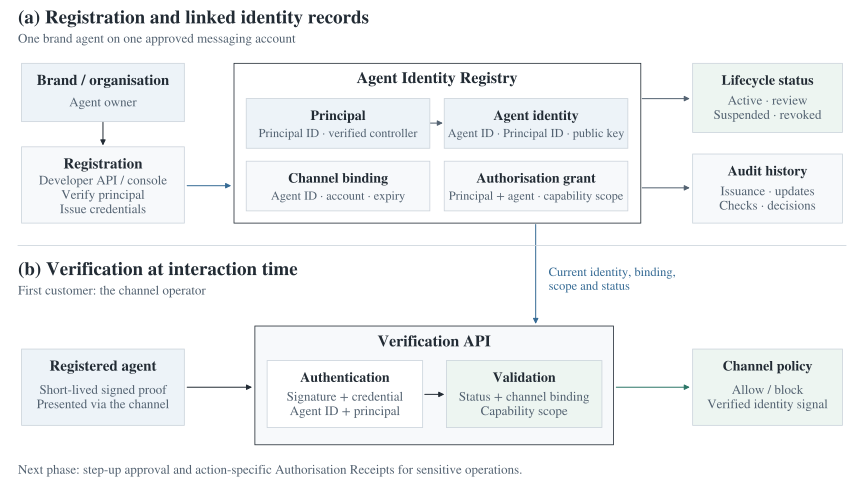

# Product definition

[Overview](../README.md) · [Discovery](discovery.md) · [Concept paper](product-concept.pdf)

**Agent Trust Gateway** is a proposed registry-backed identity and verification platform. It gives a channel current evidence about an agent, the principal it represents and its approved channel binding before the channel accepts an interaction.

## Customer and first use case

The primary customer is a **communication channel operator**. The first scenario is a brand-owned customer-support agent on a business messaging channel.

| Moment | Proposed interaction |
| --- | --- |
| Before | The channel recognises a business account but lacks a separate, current check of the agent generating the conversation. |
| Registration | The brand verifies its organisation principal, registers the agent and binds the Agent ID to an approved messaging account. |
| Conversation start | The agent presents a short-lived signed proof. The verification path checks the caller's credentials against the registered identity and current policy evidence. |
| Channel decision | The channel receives a structured result and allows or blocks the interaction. A valid result supports a recipient-facing identity signal. |

The first useful outcome is recognition of the registered brand agent during the interaction, with invalid, suspended or incorrectly bound identities denied the verified result.

## Identity model

| Record | Core fields | Purpose |
| --- | --- | --- |
| **Principal** | Principal ID, type, verified name, assurance level, jurisdiction where required and lifecycle status. | Identifies the person, organisation or system responsible for the agent. |
| **Agent identity** | Persistent Agent ID, linked Principal ID, display name, type, declared purpose, capabilities, software/model version, public key and status. | Identifies the agent as a separate actor. |
| **Channel binding** | Agent ID, channel type, approved account or endpoint, permitted purpose, status, issue time and expiry. | Connects one agent to each approved channel surface. |
| **Authorisation grant** | Principal ID, Agent ID, capability or action, resource, limits, context, validity window and status. | Defines permitted scope. V1 uses capability scopes; action-specific receipts are planned next. |

The Agent ID remains stable when the display name, channel account or software version changes. The concept calls for a new Agent ID when a change in principal or control boundary represents a different independent actor.

### Record access

Owners update declared metadata through the developer interface. The platform writes verification, credential and lifecycle state. Channels receive read-only verification access and can submit abuse signals. The pilot uses central governance so issuance, suspension and revocation follow the same rules.

## Runtime verification

| Check | Question | Evidence |
| --- | --- | --- |
| **Authentication** | Is the current caller the registered agent? | Signed runtime proof, credential validity, registered public key and matching Agent ID. |
| **Validation** | Is this agent permitted on this channel now? | Principal relationship, lifecycle and revocation status, approved binding and capability scope. |
| **Channel policy** | Should this interaction proceed? | The structured verification result and the channel's access policy. |

The recipient-facing signal has a narrow meaning: **verified agent identity, verified principal and authentication for this channel**. Identity verification does not establish the truth of a response or approve every action the agent could take.

Sensitive operations such as refunds, purchases and account changes are assigned to a later step-up flow with action-specific Authorisation Receipts. Reused proofs, unexpected credential changes, unapproved channels and verified abuse reports are review or revocation triggers in the concept.

## First-version boundary

| Included in V1 | Reason |
| --- | --- |
| Principal verification, agent registration and channel binding. | Establish the agent's identity and its relationship to the brand and account. |
| Credential issuance and runtime authentication. | Connect an incoming caller to the registered identity. |
| Verification API, validation, lifecycle status and revocation. | Let one channel check current evidence and stop accepting invalid identities. |
| Developer API/console, one channel adapter and audit history. | Support registration, channel integration and review of identity events. |

| Deferred | Planned stage | Reason |
| --- | --- | --- |
| Step-up approval and action-specific Authorisation Receipts. | Next · 3–6 months. | Add approval for sensitive actions after the initial identity path is established. |
| Broader behavioural scoring and controlled federation. | Later · 6–12 months. | Extend trust signals and issuer participation after the pilot establishes shared verification rules. |
| A universal trust score. | Outside the first year. | Identity, authority and behaviour need distinct evidence and interpretation. |

The architecture defines components, responsibilities and data flows at product level. Protocol formats and detailed service implementation remain design work for a subsequent engineering phase.

## Governance before launch

The product needs agreed evidence and assurance levels, rules for suspension and revocation, an appeals process, a way to correct false positives and clear responsibility for the verified signal. These decisions affect onboarding, channel policy and what recipients can infer from verification.

[Roadmap and exit conditions](roadmap.md) · [Figure source](../scripts/draw_figures.py)
